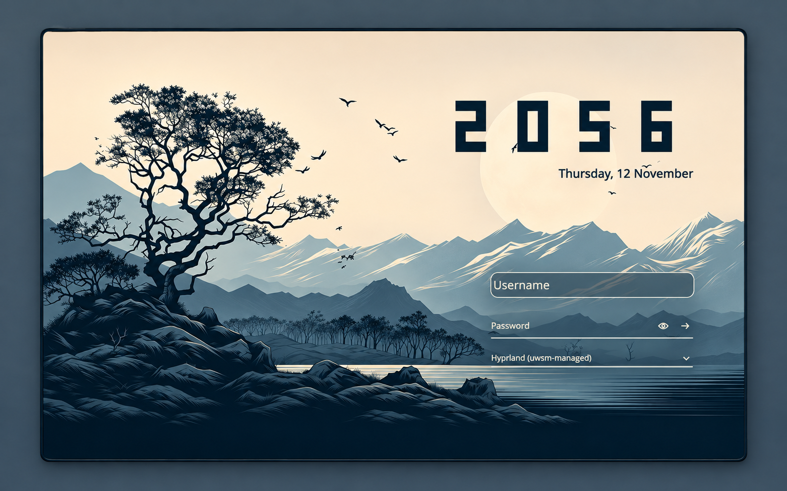

# SDDM login

**Arch Linux + Hyprland only.** I wanted a little personalization and wanted my login screen to look better, so I made this.

[Original screenshot](docs/login.png)

A simple login screen with a geometric clock and my wallpaper. [Setup and preview instructions](GUIDE.md).

The dark background fallback keeps the controls usable if the wallpaper fails to load. Breeze is still installed as a recovery option if an update breaks the theme; switching back may require a TTY, it isn't an automatic fallback.

[Recovery instructions](GUIDE.md#install-and-recover) · [Source](SOURCE.json)
